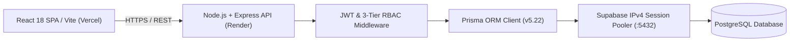

# SmartHR Enterprise — Human Resource Management Platform

> Enterprise-grade workforce directory, 3-tier RBAC hierarchy, attendance telemetry, leave approval workflows, and performance appraisal management.

[](https://github.com/rajkelangork-alt/Smart_HR/actions/workflows/ci.yml)


**Live demo:** [smart-hr-woad.vercel.app](https://smart-hr-woad.vercel.app) | **Repository:** [github.com/rajkelangork-alt/Smart_HR](https://github.com/rajkelangork-alt/Smart_HR)

---

## Demo Logins

The platform boots with a clean-slate production directory provisioned with the root **Super Admin** account. From the dashboard, you can dynamically create custom departments, designations, department managers, and employee accounts to test cross-tier workflows.

| Role               | Email                  | Password       | Access                                                         |
| :----------------- | :--------------------- | :------------- | :------------------------------------------------------------- |
| Super Admin (HR)   | `admin@smarthr.com`    | `Admin@123`    | Full system administration, org provisioning, global approvals |
| Department Manager | `manager@smarthr.com`  | `Manager@123`  | Department roster oversight, team leave & attendance review    |
| Employee           | `employee@smarthr.com` | `Employee@123` | Personal profile, daily check-in/out, leave requests           |

---

## 1. Problem & Solution

- **Problem:** Growing organizations struggle with fragmented spreadsheets for employee records, manual leave tracking, and rigid permission systems that fail to separate global HR administration from departmental management.
- **Solution:** A full-stack, type-safe HR management platform built with Node.js, Express, TypeScript, Prisma ORM, and React 18. It enforces a 3-tier RBAC hierarchy (`ADMIN`, `MANAGER`, `EMPLOYEE`), automates attendance telemetry, and streamlines leave and performance workflows over a pooled Supabase PostgreSQL database.
- **Outcome:** Zero-mismatch database bindings via Prisma, sub-50ms query responses over IPv4 session pooling, and real-time organizational directory management.

---

## 2. Key Features

- **3-Tier Role-Based Access Control (RBAC):** Granular permission guards isolating Super Admin governance, Department Manager team oversight, and Employee self-service portals.
- **Dynamic Workforce & Org Directory:** Full CRUD lifecycle for departments, designations, and employee profiles with relational integrity.
- **Attendance Telemetry & Check-In Engine:** Real-time daily clock-in/clock-out tracking with work-hour computation and status logs.
- **Leave Request & Approval Pipeline:** End-to-end leave application workflow with manager/admin review, balance validation, and status transitions.
- **Quick-Login Credential Roster:** Built-in `/api/v1/auth/roster` endpoint enabling one-click persona switching on the login screen for rapid evaluation.

---

## 3. Architecture



### Key Design Decisions

| Decision              | Choice                                | Why                                                                | Alternative               |
| :-------------------- | :------------------------------------ | :----------------------------------------------------------------- | :------------------------ |
| Database Connectivity | Supabase IPv4 Session Pooler (:5432)  | Prevents IPv6 routing failures on cloud containers & manages pools | Direct DB host (:5432)    |
| ORM & Type Safety     | Prisma ORM (v5.22) + explicit `@@map` | Compile-time TypeScript validation & zero-mismatch table bindings  | Raw SQL / TypeORM         |
| Authentication        | Dual JWT (Access 1h + Refresh 7d)     | Stateless horizontal scaling with secure session renewal           | Server-side session store |
| Seed Strategy         | Idempotent Root Super Admin bootstrap | Avoids pooler circuit-breaker trips (ECIRCUITBREAKER) & dead data  | Heavy mock data scripts   |

### Tech Stack

| Layer          | Technology                                                                                      |
| :------------- | :---------------------------------------------------------------------------------------------- |
| Backend        | Node.js, Express.js, TypeScript, Prisma ORM (v5.22.0), bcrypt, JSON Web Tokens (jsonwebtoken)   |
| Data           | PostgreSQL (Supabase), Supavisor IPv4 Session Pooler (aws-0-ap-northeast-1), Redis (Cache/Jobs) |
| Frontend       | React 18, TypeScript, Vite, Tailwind CSS, Lucide React, Axios                                   |
| DevOps & Cloud | GitHub Actions (CI/CD), Vercel (Frontend SPA), Render (Backend Web Service)                     |

---

## 4. Project Structure

```
.
├── .github/workflows/          # GitHub Actions CI pipeline
│   └── ci.yml
├── hr-be/                      # Node.js + Express + TypeScript backend
│   ├── prisma/                 # schema.prisma & idempotent seed script
│   ├── src/
│   │   ├── config/             # Environment & Prisma client singleton
│   │   ├── controllers/        # Route handlers (auth, employees, departments, leaves)
│   │   ├── middleware/         # JWT verification & RBAC role guards
│   │   ├── routes/             # Versioned API routers (/api/v1/*)
│   │   └── index.ts            # Express application entrypoint
│   ├── package.json
│   └── tsconfig.json
├── hr-frontend/                # React 18 + TypeScript + Vite frontend
│   ├── src/
│   │   ├── components/         # Reusable UI layouts, modals, and data tables
│   │   ├── context/            # AuthContext & role state management
│   │   ├── pages/              # Dashboard, Employees, Departments, Attendance, Leaves
│   │   ├── services/           # Axios instance with Bearer token interceptors
│   │   └── main.tsx            # React DOM entrypoint
│   └── vercel.json             # SPA client-side routing rewrites
├── .gitignore
└── README.md
```

---

## 5. API Overview

| Method | Endpoint                      | Description                                                              | Auth               |
| :----- | :---------------------------- | :----------------------------------------------------------------------- | :----------------- |
| GET    | `/api/v1/auth/roster`         | Fetch active system roster for quick-login credential cards              | Public             |
| POST   | `/api/v1/auth/login`          | Authenticate credentials and issue Access + Refresh JWTs                 | Public             |
| GET    | `/api/v1/employees`           | List employee directory (scoped by caller role and department)           | Bearer (All Roles) |
| POST   | `/api/v1/employees`           | Provision a new employee profile, user account, and role assignment      | Bearer (ADMIN)     |
| GET    | `/api/v1/employees/:id`       | Retrieve full employee profile with department, designation, and manager | Bearer (All Roles) |
| GET    | `/api/v1/departments`         | List organizational departments and assigned department managers         | Bearer (All Roles) |
| POST   | `/api/v1/departments`         | Create a new department with unique code and manager binding             | Bearer (ADMIN)     |
| POST   | `/api/v1/attendance/check-in` | Record daily employee clock-in timestamp                                 | Bearer (All Roles) |
| GET    | `/api/v1/leaves`              | Retrieve leave requests (scoped to self, department, or global)          | Bearer (All Roles) |

---

## 6. Getting Started

**Prerequisites:** Node.js 18+, npm, and a PostgreSQL instance (Supabase).

### Backend (`hr-be`)

```bash
cd hr-be
npm install

# Configure environment variables
cp .env.example .env
# Update DATABASE_URL with your Supabase IPv4 Session Pooler URI (?sslmode=require)
# Update JWT_SECRET and JWT_REFRESH_SECRET

# Generate Prisma client and compile TypeScript
npx prisma generate
npm run build

# (Optional) Seed the root Super Admin account
npx ts-node prisma/seed.ts

# Start development server
npm run dev
```

### Frontend (`hr-frontend`)

```bash
cd hr-frontend
npm install
npm run dev
```

---

## 7. Testing & Quality

Verify zero TypeScript compilation errors and Prisma schema alignment before deployment:

```bash
cd hr-be
npx prisma validate
npm run build

cd ../hr-frontend
npm run build
```

---

## 8. Security

- **Password Hashing:** bcrypt salted password hashes stored in PostgreSQL; raw passwords are never logged or returned.
- **Role-Based Route Guards:** Express middleware verifies JWT signatures and enforces `ADMIN`, `MANAGER`, and `EMPLOYEE` access scopes on every protected route.
- **Environment Protection:** Secrets and database pooler credentials are strictly isolated inside `.env` files and excluded via `.gitignore`.

---

## 9. Deployment

- **Frontend:** Deployed on Vercel ([smart-hr-woad.vercel.app](https://smart-hr-woad.vercel.app)) with SPA rewrite rules (`vercel.json`).
- **Backend:** Deployed on Render, connected to Supabase PostgreSQL via IPv4 Session Pooler.
- **CI/CD:** Automated build and schema verification via GitHub Actions (`.github/workflows/ci.yml`).

---

## 10. What I Learned / Trade-offs

**Self-Referential Foreign Key Constraints:** Because the `Employee` model maintains a self-referential `managerId` hierarchy alongside Department creator pointers, executing standard bulk deletions triggers PostgreSQL foreign-key constraint violations. I solved this by decoupling and nullifying `managerId` and `creatorId` references via `.updateMany()` inside a transaction prior to record teardown.

**Relational Scope Filtering vs. Over-Fetching:** Instead of filtering employee rosters and leave requests in application memory, we pushed RBAC role checks (`ADMIN`, `MANAGER`, `EMPLOYEE`) directly into Prisma `where` clauses, ensuring Department Managers only query records bound to their specific `departmentId`.

**Stateless Dual-JWT vs. Server-Side Sessions:** I prioritized stateless Access + Refresh JWT tokens over Redis-backed session stores to keep the Express middleware lightweight and horizontally scalable, trading off instant server-side token revocation for simpler stateless verification.

---

## 11. Author

**Product Full Stack Developer** | TypeScript, Node.js, Python/FastAPI, React, Next.js, PostgreSQL

GitHub: [@rajkelangork-alt](https://github.com/rajkelangork-alt) | Live Platform: [smart-hr-woad.vercel.app](https://smart-hr-woad.vercel.app)

Available for freelance software engineering and full-stack development projects.

---

## License

This project is licensed under the MIT License.
